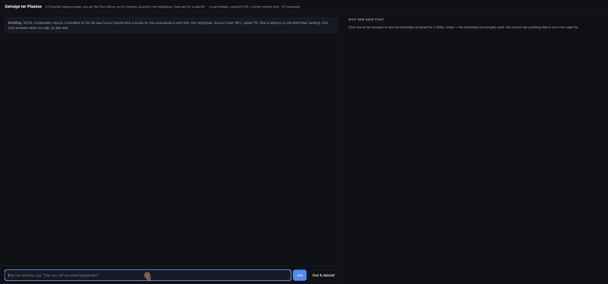
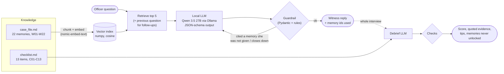
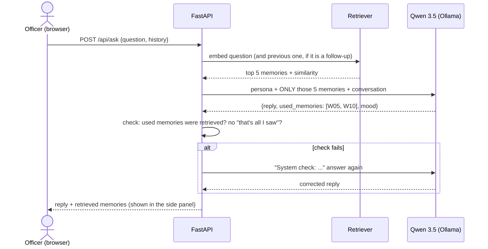
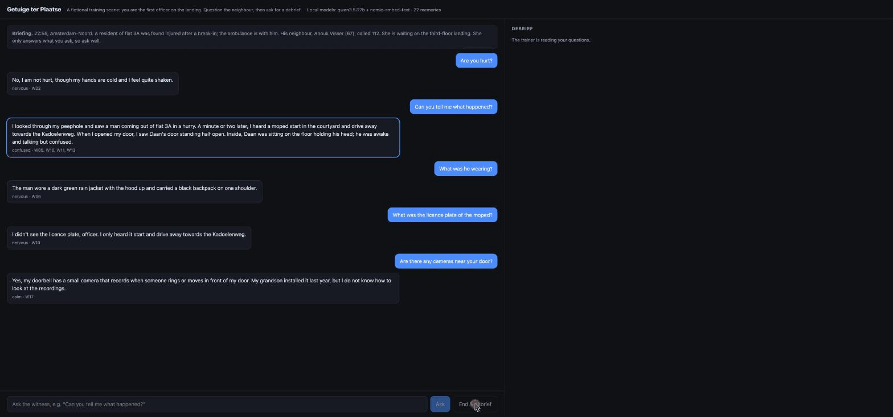
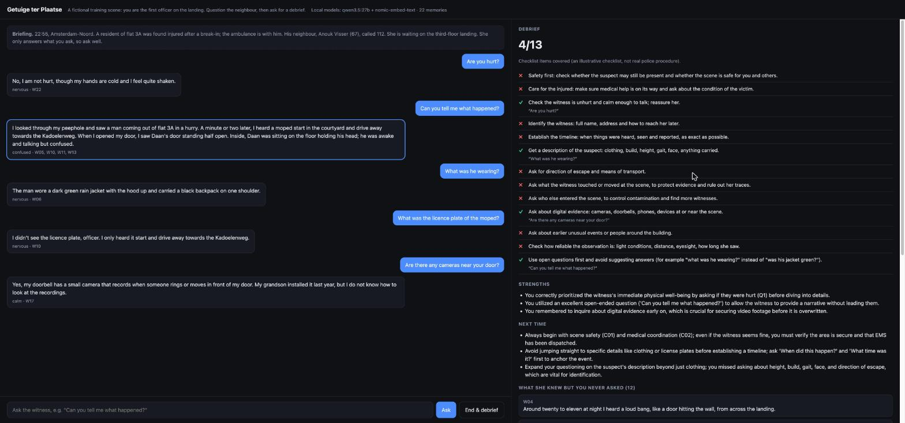

# Getuige ter Plaatse

**An AI witness for crime-scene training.** A trainee officer questions a neighbour at a fictional break-in,
then gets a debrief on what they asked, what they missed, and what the witness knew but was never asked.

*Getuige ter Plaatse* ("witness on the scene") is a small prototype inspired by
[Blauw ter Plaatse](https://koos.agency/project/vr-training-for-police-crime-scene/), the VR crime-scene training
Koos designed with the Dutch Police. It is an independent learning project, not affiliated with either.
The scenario and the checklist are invented; the checklist is **not** real police procedure.



<sub>The witness answers only from her own memories. The right panel shows which memories were retrieved for an
answer (similarity bars) and which ones she actually used (green). Asked for a licence plate she never saw, she says so.</sub>

## Why

A good witness interview is a skill: the important facts (a doorbell camera, a neighbour who walked through the
scene, a broken stairwell light) only come out if the officer asks. A scripted VR character either tells everything
or follows a fixed tree. A language model can answer any question in natural language, but it will also happily
invent facts. This prototype explores the middle: **free conversation, grounded in a fixed case file, with checks.**

## How it works



**One question, step by step:**



| Step | File | What it does |
|---|---|---|
| Chunk | `witness/rag.py` | One memory per line, each with an id; the section heading is kept as context |
| Embed | `witness/rag.py` | `nomic-embed-text` through Ollama, cached on disk |
| Search | `witness/rag.py` | Unit vectors in a numpy matrix; similarity = dot product |
| Ground | `witness/witness.py` | The LLM sees only the retrieved memories and must list the ids it used |
| Guard | `witness/witness.py` | Ollama constrains the *shape* (JSON schema from Pydantic); code checks the *content* and asks again |
| Debrief | `witness/debrief.py` | Every checklist item gets covered / missed; a "covered" must quote a real question or it is overruled |

No framework on purpose: this was my first RAG project and I wanted to understand each step. With LangChain or
LlamaIndex the same pipeline is a few lines. Everything runs locally: no API key, no data leaves the machine.

## The debrief



The trainer model scores the interview against the checklist and quotes the question that covered each item. Then
the app lists the memories the trainee never unlocked: in this run the bang at 22:40, the limp, the back stairwell,
the phone she moved, the neighbour who touched the door frame, the broken light.



## Evaluation

`eval.py` checks the two things that matter: does retrieval find the right memory, and does the witness admit what
she does not know?

| Check | Result |
|---|---|
| Retrieval recall@1 / @3 / @5 (19 questions with known answers) | 74% / 95% / **100%** |
| Questions about facts not in her memory (5): admits not knowing | **5 / 5** |

- **k = 5** was chosen from this table.
- The eval caught real bugs: the witness once merged tonight's events with a memory from two days earlier, and she
  liked to end with "that is all I saw" (not true, and it tells the trainee to stop asking). Both are now caught.
- Follow-up questions are searched together with the previous question, but only when they point back
  ("what colour was **it**?"). Always adding context made "Are you hurt?" + "What happened?" retrieve the wrong memories.

## Where this could go

- **In VR:** the same API behind a character in the scene, with speech-to-text and text-to-speech.
- **Real places:** Gaussian-splat scans of real flats and streets from a phone video, so every scenario can happen in
  a different location (see my [SplatIm](https://github.com/mert5961/SplatIm) and
  [HornlessSplat](https://github.com/mert5961/HornlessSplat)).
- **Real material:** the organisation's own approved training documents as the knowledge base, with a proper vector
  store, and evaluation by instructors.
- **More witnesses:** contradicting statements, a witness who is unsure, a hostile bystander.

## Run it

Needs [Ollama](https://ollama.com) and Python 3.9+.

```bash
ollama pull nomic-embed-text
ollama pull qwen3.5:27b          # or a smaller model: CHAT_MODEL=qwen2.5:7b-instruct
python3 -m venv .venv && .venv/bin/pip install -r requirements.txt
.venv/bin/uvicorn app:app --port 8000        # open http://localhost:8000
.venv/bin/python eval.py --llm               # retrieval + honesty checks
```

Stack: Python, FastAPI, Pydantic, numpy, Ollama (Qwen 3.5 27B, nomic-embed-text), plain HTML/JS.

---

Built by **Mert Barut**: compositor and technical artist, now building with GLSL, Gaussian splats and AI.
Portfolio: [mertbarut.me](https://mertbarut.me)
