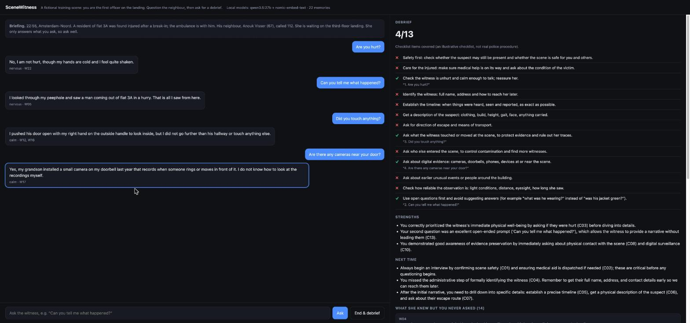

# SceneWitness

A small prototype: question an AI witness at a (fictional) crime scene, then get a debrief on what you
asked and what you missed. Built in a few days as a learning project for retrieval-augmented generation (RAG).

It is a sketch of one idea for VR police training: the trainee walks the scene, the witness answers like a
person who only knows what she saw, and the debrief shows the "mental checklist" the trainee should build.
The scenario and the checklist are invented for this demo; the checklist is **not** real police procedure.



## How it works

```
officer question ─► embed ─► search the witness's memories (cosine) ─► top 5 memories
                                                                          │
              validated JSON  ◄── Pydantic check ◄── local LLM answers ◄──┘ only from those memories
              (reply, mood, memory ids used)          (Ollama, JSON-schema output)

end of interview ─► LLM trainer compares questions with the checklist ─► Pydantic + checks ─► debrief
```

- **Chunk** (`witness/rag.py`): the case file is one memory per line, each with an id (`W05`).
- **Embed:** `nomic-embed-text` through Ollama; vectors cached on disk.
- **Search:** a numpy matrix of unit vectors; similarity = dot product. The question is searched alone and
  with the previous question as context, then merged (helps follow-ups without derailing new topics).
- **Ground** (`witness/witness.py`): the LLM only sees the retrieved memories and must list the ids it used.
- **Guardrail:** Ollama constrains the output to the Pydantic JSON schema (shape); the code then checks the
  content: if she cites a memory she was not given, the answer is rejected and retried.
- **Debrief** (`witness/debrief.py`): every checklist item gets covered / missed; a "covered" must quote a real
  question of the trainee, otherwise it is overruled. The UI also lists the memories she never got to tell.
- Everything runs locally: no API key, no data leaves the machine.

No framework on purpose: the point was to understand each step. With LangChain or LlamaIndex the same
pipeline is a few lines; a real version would also need a proper vector store and the organisation's own
approved training material as the knowledge base.

## Evaluation (`eval.py`)

| Check | Result |
|---|---|
| Retrieval recall@1 / @3 / @5 (19 questions with known answers) | 74% / 95% / **100%** |
| Questions about facts she does not have (5): admits not knowing | 5 / 5 |

k = 5 was chosen from this table. The eval also caught a real bug: asked "did he say anything?", the witness
merged tonight's events with a memory from two days earlier. Fixed in the memory text and the prompt.

## Run

```bash
ollama pull nomic-embed-text && ollama pull qwen3.5:27b   # or set CHAT_MODEL=qwen2.5:7b-instruct
python3 -m venv .venv && .venv/bin/pip install -r requirements.txt
.venv/bin/uvicorn app:app --port 8000      # open http://localhost:8000
.venv/bin/python eval.py --llm
```

Stack: Python, FastAPI, Pydantic, numpy, Ollama (Qwen 3.5 27B, nomic-embed-text), plain HTML/JS.

Mert Barut · [mertbarut.me](https://mertbarut.me)
